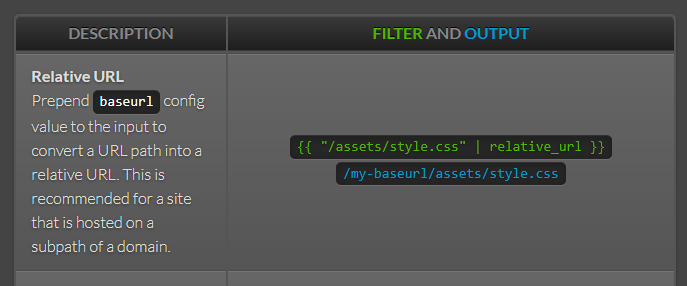

[Relative_url](https://jekyllrb.com/docs/liquid/filters/) это фильтр, он добавляется к ссылкам, чтобы в начале этой ссылки, при сборке подставлялся **baseurl**, который прописан в 
```_congfig.yml``` как ключ **baseurl**.


Как соберается ссылка без *relative_url* в примере:
```html
<a href="/">Главная</a>
```
Остается как есть, будет вести в корень  сервера.  
(Заметка. Корневой каталог сервера для запросов. 
Настраивается через ***DocumentRoot*** в [Apache](https://httpd.apache.org/docs/current/mod/core.html#documentroot), через ***root*** в [Nginx](http://nginx.org/ru/docs/http/ngx_http_core_module.html#root)).

Как собератся ссылка с: 
```yaml
baseurl: my_directory
```

```html
<a href={{ "/" | relative_url }} >Главная</a>
```

Соберется как ```/my_directory/``` и приведет именно туда.

Единственное предназначение фильтра **relative_url** - подставлять значение ключа ***baseurl*** в начало ссылки.
